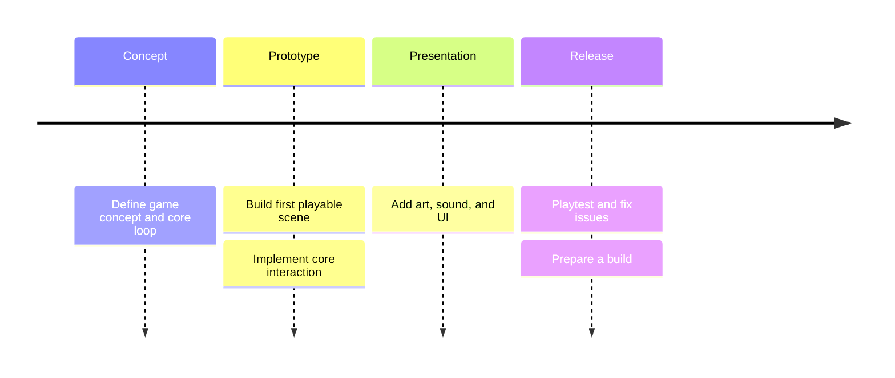
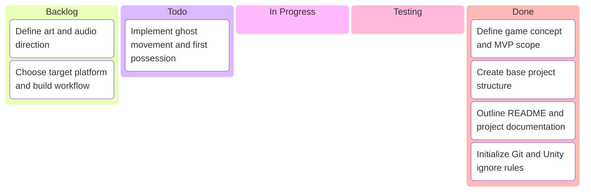

<h1 align="center"> 🎃 halloween-2026 🎃 </h1>

<p align="center">
  
</p>

A Unity project for Halloween 2026. Currently at the gameplay foundation stage, with a project structure based on mousestaurant.

## Overview

Play as a little ghost during one Halloween night: possess objects, scare pedestrians, collect candy, and cause mischief to score as many points as possible before dawn.

The repository contains a technical foundation for the night, scoring, persistent progress, and environment. See the [short game design document and MVP scope](Docs/Gameplay.md) for the planned gameplay and [architecture](Docs/Architecture.md) for the implemented APIs.

## Features

- Universal Render Pipeline configuration.
- Starter Input System actions.
- Dedicated folders for project assets and documentation.
- Timed night with pause, completion, and a configurable moon/sky cycle.
- Score categories, saved records, and persistent secret discoveries.
- Development controls for exercising the foundation; player/NPC gameplay is not implemented yet.

## Screenshots

TODO: Add screenshots once the first playable prototype is ready.

## Installation

1. Install Unity Editor `6000.4.7f1` through Unity Hub.
2. Add this repository folder as a project and open it.
3. Allow Unity to restore the packages declared in `Packages/manifest.json`.

## Usage

Open `Assets/InternalAssets/Scenes/SCN_Main.unity` and press Play to exercise the foundation. The development panel can award points, advance time, discover the sample secret, pause, and restart. Tune `Assets/InternalAssets/Data/NightSettings.asset` in the Inspector.

If setting up a fresh scene, use **Halloween → Set Up Foundation Scene** once.

With Unity CLI installed, open the project from the repository root:

```bash
unity open .
```

## Project Structure

```text
halloween-2026/
├── Assets/
│   ├── InternalAssets/
│   │   ├── Data/
│   │   ├── Input/
│   │   ├── Models/
│   │   │   ├── Materials/
│   │   │   └── Textures/
│   │   ├── PhysicsMaterials/
│   │   ├── Prefabs/
│   │   │   ├── Actors/
│   │   │   ├── App/
│   │   │   ├── Architecture/
│   │   │   ├── Holdable/
│   │   │   ├── Props/
│   │   │   └── UI/
│   │   ├── Scenes/
│   │   │   └── SCN_Main.unity
│   │   ├── Scripts/
│   │   │   ├── App/ (Editor, Session, Progress)
│   │   │   ├── Gameplay/ (Actor, Environment)
│   │   │   ├── Shared/
│   │   │   └── UI/
│   │   ├── Sprites/UI/
│   │   └── Tests/Editor/
│   ├── Settings/
│   └── TutorialInfo/
├── Docs/
│   ├── Architecture.md
│   ├── Assets.md
│   ├── CodeStyle.md
│   ├── Gameplay.md
│   └── NamingConvention.md
├── Packages/
├── ProjectSettings/
└── README.md
```

## Configuration

Project settings live in `ProjectSettings/`; package dependencies and their resolved versions live in `Packages/`. Change dependencies through Unity Package Manager.

## Development

- Keep project-owned assets in `Assets/InternalAssets/`.
- Commit Unity `.meta` files together with their assets; preserve them when moving assets.
- Empty asset folders contain `.gitkeep` files so Git preserves the initial structure.
- Generated caches, builds, IDE files, and local agent settings are ignored.
- Follow [code style](Docs/CodeStyle.md) and [naming conventions](Docs/NamingConvention.md).
- Update the relevant document in `Docs/` when adding a system or changing a gameplay flow.

## Roadmap



These are planning placeholders; gameplay and release scope are not yet decided.

## Development Board



## Contributing

Keep changes focused, test affected scenes in Unity, and update documentation alongside implementation.

## License

TODO: Choose a license. No license file has been added yet.

## Credits

Project structure and documentation layout adapted from mousestaurant. Add asset authors and license details to [Docs/Assets.md](Docs/Assets.md) as assets are introduced.
